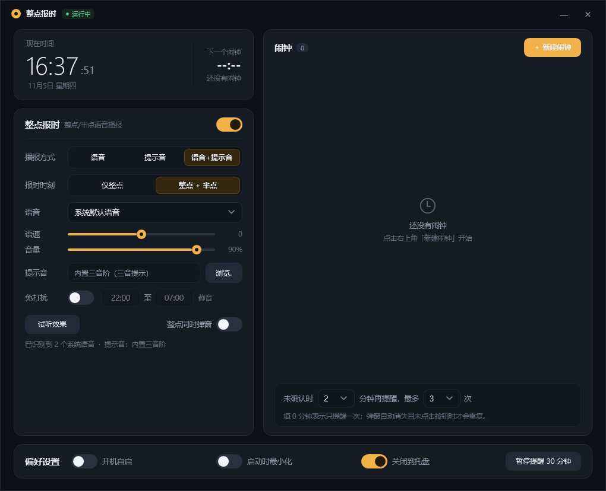
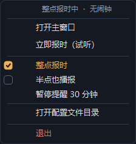

# HourChime · 整点报时

[](https://github.com/OPEN96/HourChime/actions/workflows/build.yml)
[](https://github.com/OPEN96/HourChime/releases)
[](LICENSE)


一个安静待在系统托盘里的 Windows 桌面小工具：**整点 / 半点用中文语音或提示音报时**，也能当闹钟用。纯本地运行，无广告、不联网、无后台服务、不上传任何数据。



> [!NOTE]
> **仓库地址**：[OPEN96/HourChime](https://github.com/OPEN96/HourChime)，文档、徽章与 Issue 模板链接均已指向该仓库。
> 首次发布前仍需：
> 1. 确认 `HourChimeWpf/HourChimeWpf.csproj` 的 `<Version>`（当前 `2.1.0`）与首个 Release tag 一致。
> 2. 提交并推送：`git add . && git commit -m "chore: initial open-source release" && git push -u origin main`。
> 3. 按 [发布流程](docs/RELEASING.md) 打 `v2.1.0` 标签，触发自动构建与 Release。
>
> 仓库中不含 `bin/`、`obj/`、`artifacts/`、个人 `settings.json` 与调试截图；`.gitignore` 已配置好。

## 功能

**报时**
- 整点 `:00` 与半点 `:30` 播报，可只开整点；中文 12 小时制文案，如「现在是下午三点半」。
- 三种播报方式：仅语音 / 仅提示音 / 语音 + 提示音；可选系统语音、语速、音量。
- 支持自定义 WAV 提示音，未配置或播放失败时回退内置三音阶。
- 90 秒补报窗口：机器刚唤醒或短暂卡顿时仍能补上；启动时不补报。
- 可选「报同时弹出卡片」。

**闹钟**
- 重复模式：每天 / 工作日 / 周末 / 仅一次，可写标签。
- 每个闹钟可单独设置贪睡分钟数与响铃方式（语音+提示音 / 仅提示音 / 静音弹窗）。
- 未确认的提醒按「间隔 N 分钟、最多 M 次」重复弹出，点「知道了」即停止；`0` 表示只提醒一次。
- 「仅一次」闹钟响过之后自动停用。

**安静与托盘**
- 免打扰时段（支持跨夜，如 22:00 → 07:00）、一键暂停提醒 30 分钟。
- 深色托盘右键菜单：直接开关整点 / 半点、查看当前状态与下一个闹钟；勾选状态用琥珀色实心勾，未勾选为空心框。
- 偏好：开机自启、启动最小化、关闭时最小化到托盘。
- 单实例互斥，避免重复响铃；崩溃日志写入 `%APPDATA%\HourChime\crash.log`。

| 托盘菜单 | Toast 提醒 |
| --- | --- |
|  |  |

<details>
<summary>勾选 / 未勾选状态对比</summary>



</details>

## 下载与运行

从 [Releases](https://github.com/OPEN96/HourChime/releases) 下载对应压缩包，解压后双击 `HourChime.exe` 即可，无需安装。

| 压缩包 | 体积 | 运行时要求 | 适合 |
| --- | --- | --- | --- |
| `HourChime-<版本>-win-x64.zip` | ≈ 64 MB | 不需要，自带 .NET 10 桌面运行时 | 想直接双击使用 |
| `HourChime-<版本>-win-x64-framework-dependent.zip` | ≈ 160 KB | 需已安装 [.NET 10 桌面运行时](https://dotnet.microsoft.com/download/dotnet/10.0) | 已装运行时、想要极小体积 |

- 系统要求：Windows 10 1809+ / Windows 11，**x64**。
- 中文语音依赖系统自带的中文 TTS 语音；没有中文语音时会自动回退到可用语音或提示音。
- 二进制未做代码签名，首次运行可能触发 SmartScreen：点「更多信息」→「仍要运行」。

每个发布包内都附带 `LICENSE`（MIT 分发要求）。Release 提供两类校验文件：与每个压缩包一一对应的 `*.zip.sha256`，以及汇总的 `SHA256SUMS.txt`；CI 在上传构建产物前会重新计算哈希并核对，不一致即中止。

校验示例（把 zip 与对应的 `.sha256` 放在同一目录）：

```powershell
Get-FileHash .\HourChime-2.1.0-win-x64.zip -Algorithm SHA256
```

```bash
sha256sum -c HourChime-2.1.0-win-x64.zip.sha256
sha256sum -c SHA256SUMS.txt
```

## 快速开始

1. 解压到任意目录，双击 `HourChime.exe`。
2. 在主窗口选择播报方式、报时时刻（仅整点 / 整点 + 半点），点「试听效果」验证声音与弹窗。
3. 需要闹钟时点右上角「新建闹钟」。
4. 之后可勾选「启动时最小化」，让它安静待在托盘；双击图标或右键「打开主窗口」可随时唤出。

## 配置

配置文件：`%APPDATA%\HourChime\settings.json`（托盘菜单「打开配置文件目录」可直接跳转）。首次保存时自动创建，内容损坏时回退默认值。

| 字段 | 默认值 | 说明 |
| --- | --- | --- |
| `HourlyEnabled` | `true` | 报时总开关 |
| `HalfHourlyEnabled` | `true` | 半点是否也播报 |
| `HourlyMode` | `"both"` | `voice` / `chime` / `both` |
| `VoiceName` | `null` | 系统语音名称，`null` 为系统默认 |
| `Rate` | `0` | 语速，范围 −10 ~ 10 |
| `Volume` | `90` | 音量，范围 0 ~ 100 |
| `HourlyToast` | `false` | 报时是否同时弹卡片 |
| `ChimePath` | `null` | 自定义 WAV 路径，空则用内置提示音 |
| `QuietEnabled` | `false` | 免打扰开关 |
| `QuietFrom` / `QuietTo` | `"22:00"` / `"07:00"` | 免打扰时段，支持跨夜 |
| `RepeatRemindMinutes` | `2` | 未确认提醒的重复间隔，`0` 表示不重复 |
| `RepeatRemindTimes` | `3` | 最多重复次数 |
| `AutoStart` | `false` | 开机自启（写入 HKCU Run 项） |
| `StartMinimized` | `true` | 启动最小化到托盘 |
| `CloseToTray` | `true` | 关闭窗口时最小化到托盘 |
| `Alarms` | `[]` | 闹钟数组 |

闹钟条目字段：`Id`、`Hour`、`Minute`、`Label`、`Repeat`（`Daily` / `Weekdays` / `Weekend` / `Once`）、`OnceDate`（`yyyy-MM-dd`）、`Enabled`、`SnoozeMinutes`（`0` 为不贪睡）、`RingMode`（`both` / `chime` / `silent`）。

> 新增字段都带默认值，旧版配置文件可直接沿用；不需要手工迁移。

## 从源码构建

需要 **Windows** + [.NET 10 SDK](https://dotnet.microsoft.com/download/dotnet/10.0)（项目同时使用 WPF 与 WinForms，无法在 Linux/macOS 构建）。Visual Studio 2022 或 VS Code + C# 扩展均可。

```powershell
dotnet restore HourChime.sln
dotnet build HourChime.sln -c Release
dotnet run --project HourChimeWpf/HourChimeWpf.csproj
```

打发布包（脚本同时被 GitHub Actions 复用）：

```powershell
powershell -NoProfile -ExecutionPolicy Bypass -File .\scripts\build.ps1 -Version 2.1.0
```

产物输出到 `artifacts/`：两个 zip 与 `SHA256SUMS.txt`；`artifacts/_stage/` 是中间产物，可以随意删除。

| 参数 | 默认值 | 说明 |
| --- | --- | --- |
| `-Configuration` | `Release` | 构建配置 |
| `-Version` | `2.1.0` | 注入到程序集版本号与压缩包文件名 |
| `-OutputDir` | `artifacts` | 输出目录（相对仓库根） |
| `-Runtime` | `win-x64` | 目标 RID |
| `-SkipSelfContained` | 关 | 跳过体积较大的自包含包，只构建框架依赖版 |

> Windows 上若执行策略禁止运行本地脚本，请使用上面的 `-ExecutionPolicy Bypass`，或改用 `pwsh`（PowerShell 7）。

**CI**：推送 `main` / 开 PR / 手动触发时自动构建并上传构建产物（保留 30 天）；推送 `v*` 标签时额外创建 GitHub Release 并附上两个 zip 与校验文件。详见 [发布流程](docs/RELEASING.md)。

### 调试参数

启动 exe 时可附加以下参数（仅供开发核对，普通用户无需关心）：

| 参数 | 作用 |
| --- | --- |
| `/minimized` | 强制以最小化到托盘方式启动 |
| `/previewtoast` | 启动后弹出一次报时预览 Toast |
| `/traypreview` | 把托盘右键菜单固定显示在屏幕上，便于核对样式 |
| `/traypreview:<png路径>` | 将托盘菜单自渲染为 PNG，完成后自动退出 |
| `/snapshot:<png路径>` | 将主窗口自渲染为 PNG，完成后自动退出 |

## 项目结构

```
.
├── .github/
│   ├── ISSUE_TEMPLATE/          # 问题 / 建议表单
│   ├── PULL_REQUEST_TEMPLATE.md
│   └── workflows/build.yml      # 构建、上传产物、tag 发版
├── docs/
│   ├── images/                  # README 配图
│   └── RELEASING.md             # 发版流程
├── scripts/build.ps1            # 本地与 CI 共用的打包脚本
├── HourChimeWpf/                # 主项目（WPF）
│   ├── Core/                    # 配置、语音、调度、平台、崩溃日志
│   ├── Styles/                  # WPF 深色主题 + 托盘菜单渲染器
│   ├── Views/                   # 主窗口、闹钟编辑、Toast、确认框
│   ├── Program.cs               # 显式入口点
│   ├── App.xaml.cs              # 应用主体、Toast 事件接线
│   └── TrayHost.cs              # NotifyIcon 与右键菜单
├── HourChime.sln
├── CHANGELOG.md
├── CONTRIBUTING.md
├── LICENSE
└── README.md
```

### 架构要点

- **WPF 做界面，WinForms 做托盘**：WPF 没有内置托盘 API，因此 `NotifyIcon` / `ContextMenuStrip` 来自 `System.Windows.Forms`，菜单外观由自定义 `ToolStripProfessionalRenderer` 绘制。
- **不用 `App.xaml` 自动入口**：混合 SDK 下会生成重复的 `Main`，改由 `Program.Main` 显式创建 `Application` 并合并 `Styles/Theme.xaml`；同时用 `<Using Remove>` 移除 `System.Windows.Forms` / `System.Drawing` 隐式 using，避免 `Brush`、`Color`、`MessageBox` 等类型歧义。
- **调度与界面解耦**：`Core/ChimeScheduler` 只依赖一个 500 ms 的 `DispatcherTimer`，通过 `Tick` / `StateChanged` / `AlarmsChanged` / `ToastRequested` 事件驱动 UI。
- **零第三方 NuGet 依赖**：只使用 .NET / Windows 平台组件与系统 SAPI 语音。
- 当前编译剩两个无害警告：`Core/SpeechService.cs` 的空引用静态分析提示、`app.manifest` 的高 DPI 设置提示。

## 已知限制

- 界面与播报目前仅支持简体中文；只提供 Windows x64 构建。
- 系统睡眠 / 休眠期间不会响铃；唤醒后若仍在 90 秒补报窗口内会补报。
- 语音质量取决于系统已安装的 SAPI 中文语音。
- 自包含单文件体积较大（≈ 64 MB 压缩包），这是打包 WPF 原生 DLL 与运行时的代价；框架依赖版约 160 KB。

## 参与贡献

欢迎提 Issue 和 PR，请先阅读 [CONTRIBUTING.md](CONTRIBUTING.md)。本项目坚持纯本地运行，不接受引入联网、账号或云端服务的改动。

## 许可证

[MIT](LICENSE) © 2026 OPEN96
